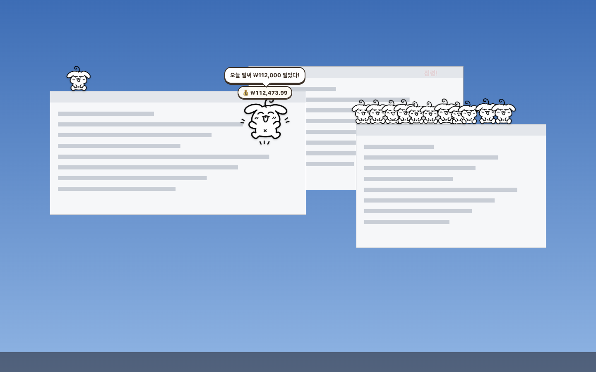

# 🖥️ 모니터 프렌즈

내 화면 위를 걸어 다니는 데스크톱 펫. 머리 위에 **1초마다 오르는 오늘 일당**·퇴근까지 남은 시간·루팡 금액을 띄우고,
끌어서 창 위에 올려놓거나 던질 수 있고, 파일을 끌어다 주면 변환·정리를 도와줘요.
우리 집 강아지·고양이 사진 + ChatGPT 이미지 생성으로 **나만의 펫**도 만들 수 있어요.

## 다운로드

- 맥 13 이상 (애플 실리콘·인텔): [MonitorFriends-mac.dmg](https://github.com/kanchoooo/monitor-friends/releases/latest/download/MonitorFriends-mac.dmg)
- 윈도우 10/11: [MonitorFriends-Setup.exe](https://github.com/kanchoooo/monitor-friends/releases/latest/download/MonitorFriends-Setup.exe) — "Windows의 PC 보호" 창이 뜨면 **추가 정보 → 실행**
- 다운로드 페이지: https://kanchoooo.github.io/monitor-friends/



- 맥 / 윈도우 (Electron 44 + TypeScript, 패널은 React)
- 기본 캐릭터 메롱이: 사용자가 ChatGPT 로 만든 시트(`src/renderer/src/assets/pets/default-sheet.webp`)를 앱의 시트 가져오기로 처리한 아틀라스(`default.png`, `MYPET_LAB=atlas` 로 다시 만듦). 예전 코드 그림 펫(`common/petart.ts`)은 lab 시험용으로만 남김
- 효과음: WebAudio 합성 (`src/renderer/src/common/sound.ts`)
- 다른 앱 창 위치·마우스 버튼: [koffi](https://koffi.dev) FFI — 비둘기 모니터에서 가져옴 (`src/main/windows/`)

## 실행

```bash
npm install
node scripts/fetch-koffi.mjs   # 맥 x64/arm64 · 윈도우용 koffi 네이티브 모듈 (패키징 때만 필요)
npm run dev                    # 개발 모드
npm test                       # 월급 계산 테스트
```

창을 닫아도 메뉴 막대(맥) / 작업 표시줄 트레이(윈도우)의 🐾 아이콘으로 계속 실행돼요. 완전히 끄려면 트레이 메뉴 → 종료.

## 펫과 놀기

| 하는 일 | 펫 |
|---|---|
| 누르기 | 메뉴: 🕶 자리비움 · 💩 화장실 · 🌐 인터넷 · 🎲 장난 · 📸 자랑하기 · 📂 파일 도우미 · 💤 재우기 · 🐾 펫 바꾸기 · ⚙️ 설정 · 🙈 숨기기 |
| 끌기 | 깜짝 놀란 얼굴로 들려서 땀을 흘림. 창 위에 놓으면 그 창 위에 앉고, 창을 옮기면 같이 움직이고, 창이 닫히면 떨어짐 |
| 휙 던지기 | 날아가서 화면 가장자리에 튕기고, 세게 떨어지면 어지러워함 (별 빙글빙글) |
| 커서로 문지르기 | 쓰다듬기 → 하트 + 골골 |
| 여러 번 누르기 | 삐짐 |
| 가만히 커서 올리기 | 손 흔들며 인사 |
| 알아서 | 걷기 · 앉기 · 일하기(노트북) · 근처 창 위로 점프 · 창 가장자리 너머로 걸어가 떨어지기 · 졸기 · 혼잣말 |
| 자리 비움 (3분 입력 없음) | 잠 (zzz) → 돌아오면 "어 왔어?" |

### 머리 위 표시 (설정에서 고르고 번갈아 보여 줌 · 표시를 누르면 다음 것)

| 항목 | 예 |
|---|---|
| 오늘 번 돈 (실시간) | `💰 ₩114,785.94` — 근무 시간에만 오름, 점심(무급)엔 멈춤 |
| 올해 번 돈 | `📅 올해 ₩35,414,812` |
| 퇴근까지 | `⏰ 퇴근까지 2:39:50` / `🌙 퇴근 12분 지남` |
| 오늘 루팡 | `🕶 오늘 루팡 ₩8,210` |
| 💩 오늘 똥값 | `💩 오늘 똥값 ₩2,340` |
| ☕ 커피·치킨 환산 | `☕ 오늘 번 돈 = 아메리카노 21잔` (치킨·국밥·맥주·라면을 돌아가며) |
| 🌙 공짜 야근 | `🌙 공짜 야근 43분째 (₩14,243 손해)` — 퇴근 뒤에도 컴퓨터를 쓰는 동안만 |
| 💳 월급날·주말 | `💳 월급날 D-6` ↔ `🏖 주말까지 31:12:05` |

- 월급 계산: 일당 = 월급(연봉 ÷ 12) ÷ 그달 근무일 수, 초당 = 일당 ÷ 하루 유급 근무 초. 공휴일은 따지지 않음. 밤샘 근무(퇴근 < 출근) 됨 (`src/shared/money.ts`, 테스트 `test/run.mts`)
- 글자 크기 설정: 폰으로 모니터를 찍어 올릴 때 크게

### 루팡 · 똥값

- 🕶 **자리비움**을 누르고 갔다가 돌아와서 다시 누르면, 그동안 근무 시간과 겹친 만큼 번 돈이 루팡 금액으로 쌓임 (자리 비운 동안 펫이 대신 노트북으로 일하는 척 + ₩ 가 퐁퐁)
- 💩 **화장실**은 똥값으로 따로 집계 (펫이 앉아서 기다리며 💩 가 퐁퐁)
- 버튼을 깜빡해도 근무 시간에 설정한 시간(기본 10분) 넘게 입력이 없다가 돌아오면 펫이 "루팡으로 적을까?" — 응 루팡 / 💩 화장실이었어 / 아니 일했어
- 누적 루팡으로 칭호: 루팡 새싹 → 인턴 → 사원 → 대리 → 과장 → 차장 → 부장 → 임원 → 전설의 월급루팡

### 시간 이벤트

- 출근 → 인사 + 오늘 일당 · 11:30 점심 메뉴 고민 · 점심 시작 냠냠 · 오후 식곤증
- 퇴근 30분 전 · 10분 전 말풍선 → **10초 카운트다운**(큰 숫자) → **꽃가루 + 춤 + "퇴근이다!!! 오늘 ₩158,730 벌었다"** + 자랑하기 버튼
- **월급날**: 처음 일할 때 화면 위에서 돈이 쏟아짐 💸

### 장난 (메뉴 🎲 · 트레이 · 패널) — 바이럴 에이전트 조사(2026-11-19)로 고름

「회사 PC 위에서 벌어져서 남에게 보여 주고 싶은 장면」 위주. 간식·발자국·춤·커서 쫓기는 공유 거리가 약해 뺐어요.

| 장난 | 화면 |
|---|---|
| 👯 분신술 | 누를 때마다 6~9마리씩 더 (최대 90). 같이 노는 펫들도 분신을 만듦. 누르면 펑 |
| 🏴 창 점령 | 앞 창 윗변부터 분신이 줄줄이 앉음. 창을 옮기면 우르르 같이 탐. 누를수록 다른 창까지 |
| 🪧 칼퇴 시위 행진 | 피켓(6시 칼퇴·야근 반대…) 든 펫 떼가 구호를 외치며 화면 바닥을 가로지름. **퇴근 10분 전에 자동** |
| 🚨 부장님 온다! | 펫·분신이 0.3초 만에 화면 밖으로 쌩 → 6초 뒤 "갔어…? 😅" 하며 슬금슬금 |
| 🎣 창 위에서 낚시 | 창 윗변에 앉아 창 안으로 낚싯줄 → 🐟 엑셀에서 월척 · 📄 결재 서류 · 📧 안 읽은 메일 37통… |
| 🧾 루팡 영수증 | 근무 시간·번 돈·루팡·똥값·커피 환산·공짜 야근·「실제로 일한 비율 n%」이 적힌 긴 영수증 |
| 🖱 커서에 매달리기 | 세게 흔들면 떨어짐 (클릭은 뒤로 통과) |
| 📝 킹받는 쪽지 | "부장님 뒤에 계심" "오늘 야근 확정" "방금 한숨 소리 다 들림" 포스트잇 |
| 🙈 숨바꼭질 | 화면 가장자리에 반쯤 숨음 → 찾아서 누르기 |

저절로: **자리 비우면 펫 떼가 창 점령 → 돌아오면 "앗 들켰다!" 후다닥** · 퇴근 시간 꽃가루 → 루팡 영수증 → **다 같이 퇴근 행렬 → "너만 남았어"** ·
야근 중 컵라면 🍜 · 월요일 오전 좀비처럼 느릿 · 금요일 오후 들썩 · 같이 노는 펫끼리 만나면 하이파이브

### 여러 마리 (함께 놓기)

내 펫 탭에서 카드를 누르면 **대표 펫**(머리 위 표시·메뉴), **＋ 함께 놓기**로 최대 5마리를 더 띄움. 모두 끌기·던지기·쓰다듬기 되고 각자 작은 말풍선으로 말함.
펫 크기를 바꾸면 말풍선·머리 위 표시 글자도 같이 커지고 작아짐.

### 자랑 이미지 (1080×1350)

"오늘의 월급 리포트": 펫 + 오늘 번 돈 + 커피·치킨 환산 + 퇴근까지(또는 공짜 야근) + 오늘 루팡 + 오늘 똥값 + 시급(최저시급의 몇 배) + 올해 번 돈 + 월급날·주말 + 칭호.
저장하면서 클립보드에도 복사 (`src/renderer/src/panel/share.ts`). 퇴근 축하·루팡 정산·월급날 말풍선에서 바로 열 수 있음.

## 나만의 펫 만들기

내 펫 탭 → **새 펫 만들기**: 무엇으로 만들지(🐶 동물 · 🧑 사람·캐릭터 · 🐟 다리 없는 것 · 🍙 물건·음식)와 그림체(귀여운 2~3등신 / 원래 그림체)·특징을 고르면 요청문이 맞춰짐 → 요청문 복사 → ChatGPT 에 사진과 함께 붙여 넣기 → 받은 그림을 끌어다 놓기 → 미리 보기 → 저장.
자세한 안내와 요청문 전문: [docs/펫만들기_가이드.md](docs/펫만들기_가이드.md) (요청문 원본은 `src/shared/petPrompt.ts`, `npm run guide` 로 문서를 다시 만듦)

- 빠진 포즈가 있으면 비슷한 포즈로 채움 (걷기 2 → 걷기 1, 잠 → 앉기 …)
- 그림 규격: 4열 × 3행 12포즈 (서기 · 눈 깜빡 · 걷기 2장 · 깜짝 놀람 · 앉기 · 잠 · 신남 · 일하기 · 냠냠 · 삐짐 · 인사) — `src/shared/pet.ts`
- 가져오기: 배경 지우기(투명/자홍/흰색) → 빈 줄·빈 칸으로 12개 나누기(안 되면 4×3 칸) → 발 높이·크기 맞추기 → 1024×768 투명 PNG (`src/renderer/src/common/sheet.ts`, 1536×1024 입력에 0.4초 안팎)
- **보내기**: 만든 펫을 `.모니터 프렌즈.png` 로 저장 → 친구가 같은 화면에 끌어다 놓으면 그대로 가져옴

## 인터넷 창

펫 메뉴 🌐 → 작은 인터넷 창 (뒤로·앞으로·주소/검색·📌 항상 위·◐ 투명도·🙈 숨기기).
**숨기기 단축키**(기본 `Ctrl+Shift+Space`, 맥 `⌃⇧Space`, 설정에서 바꿈)를 누르면 어느 앱을 쓰던 중이든 **이 창만** 숨고 소리도 꺼짐 → 다시 누르면 그대로 돌아옴.
"숨길 때 펫도 같이 숨기기"도 있음. 새 창 링크는 같은 창에서 열려요(창이 하나라야 숨기기가 의미 있음). `src/main/browser.ts`

## 파일 도우미

펫 위에 파일을 떨어뜨리면(또는 패널 파일 도우미 탭) 고를 수 있는 도구가 뜸. **원본은 그대로** 두고 옆에 `이름_pet.확장자` 로 새로 만듦 (폴더에 못 쓰면 바탕화면).

| 도구 | 옵션 |
|---|---|
| 🔁 형식 바꾸기 | JPG · PNG · WEBP (아이폰 HEIC → JPG 는 맥만) |
| 크기 줄이기 | 50% · 25% · 가로 1920/1280/1080/720 (키우지는 않음) |
| 용량 줄이기 | 보통 · 많이 · 아주 많이 / 자동·JPG·WEBP (원본보다 커지면 건너뜀) |
| 가운데 자르기 | 1:1 · 4:5(인스타) · 16:9 · 9:16 |
| 돌리기 | 오른쪽 · 왼쪽 · 180° · 좌우 뒤집기 |
| 흑백 · 촬영 정보(EXIF·위치) 지우기 | |
| PDF 로 묶기 | A4 · 원본 크기 (2장 이상) |
| 세로로 이어 붙이기 | 캡처 여러 장 → 긴 한 장 (2장 이상) |
| GIF 만들기 | 동영상 앞부분 5초/8초 · 360/480/640 |
| 글자 수 세기 | 공백 포함/제외 · 줄 · 단어 · 원고지 매수 (EUC-KR 도 읽음) |
| 압축하기 | zip (폴더도 됨) |
| 이름 정리 | 날짜 붙이기 · 일련번호 (이건 원본 이름을 바꿈) |
| 경로 복사 · 🗑 휴지통으로 | 펫이 냠냠 먹음 (휴지통에서 되살릴 수 있음) |

이미지 처리는 숨은 작업 창(Chromium 캔버스)에서 하고, HEIC 는 맥 `sips` 로 먼저 풀어요. PDF·zip 은 직접 씀(fflate), GIF 는 gifenc. `src/main/tools/`, `src/renderer/src/tools/`

## 구조

```
src/main/
  index.ts      앱 · 트레이 · 패널 · 자리비움/루팡 · 단축키 · IPC · 테스트 자동화
  overlays.ts   디스플레이마다 투명 전체화면 창. 펫·말풍선·메뉴(hot 영역) 위에서만 클릭을 받고 나머지는 통과.
                커서·버튼은 메인이 60Hz 로 읽어 보냄. 펫을 끌고 다른 모니터로 넘어가면 그 화면 창이 이어받음
  perches.ts    창 목록 → 앉을 자리 (창 윗변 중 앞 창에 가리지 않은 구간 + 화면 바닥)
  windows/      창 위치 (mac: CoreGraphics, win: user32+DWM) · 마우스 버튼 (NSEvent / GetAsyncKeyState)
  browser.ts    인터넷 창 (BaseWindow + 막대·페이지 WebContentsView 두 겹)
  store.ts      설정 · 루팡 기록 · 내 펫 (userData/state.json, userData/pets/*.png)
  tools/        파일 도우미
src/shared/     월급 계산(money) · 펫 규격(pet) · 요청문(petPrompt) · 도구 목록(toolDefs) · 타입
src/renderer/src/
  overlay/      펫 세상: world(입력·행동·표시·메뉴·장난·시간 이벤트) · pet(물리·포즈) · fx · lines(대사)
  panel/        오늘 · 내 펫(+ 만들기) · 파일 도우미 · 설정 · 정보 · 처음 화면 · 자랑 이미지
  browser/      인터넷 창 위쪽 막대
  tools/        파일 도우미 작업 창 (이미지·GIF)
  common/       기본 펫 그림 · 시트 가져오기 · 아틀라스 · 효과음
  lab/          그림 확인용 (앱에는 안 들어감)
```

### 클릭 받기
- 맥: 누르기·떼기는 DOM pointer 이벤트(트랙패드 탭처럼 아주 짧은 클릭까지), 커서 위치·다른 화면에서 놓기는 메인이 읽은 값
- 윈도우: 포커스 없는 창의 클릭은 Chromium 이 버리므로(비둘기 모니터에서 겪음) 메인이 읽은 버튼 상태로 누르기·떼기를 만들고, 버튼은 `elementFromPoint` 로 누름
- 펫을 끄는 동안은 화면 전체가 클릭을 받음(놓을 때까지). 커서에 매달리기 중에는 펫이 클릭을 막지 않음

## 테스트 (헤드리스)

가짜 화면(1440×900)과 가짜 창 3개로 돌려 PNG 로 확인. 환경변수 목록은 `src/main/env.ts`.

```bash
npm run build
MYPET_HEADLESS=1 MYPET_NOW=2026-11-25T17:59:36 MYPET_SCRIPT=test.json MYPET_SHOT_DIR=shots npx electron .
# test.json 예: [{"at":2500,"shot":"landed"},
#   {"at":3000,"js":"__world.domDown(470,800,0)"},{"at":3050,"drag":[470,800,430,190,500]},   펫 끌어 던지기
#   {"at":5000,"windows":[...]},                                                             창 옮기기·닫기
#   {"at":6000,"dropped":["/경로/사진.jpg"]},                                                 파일 떨어뜨리기
#   {"at":7000,"command":{"type":"prank","name":"clone"}}, {"at":8000,"command":{"type":"party"}},
#   {"at":9000,"lupang":true}, {"at":9500,"browser":true}, {"at":9800,"boss":true},
#   {"at":10000,"panelJs":"…"}, {"at":10500,"panelShot":"home"}, {"at":11000,"quit":true}]
MYPET_LAB=icon MYPET_SIZE=1024x1024 MYPET_SHOT=build/icon.png npx electron .            # 앱 아이콘 다시 만들기
MYPET_LAB=example MYPET_SIZE=1600x1100 MYPET_SHOT=docs/img/example-sheet.png npx electron .   # 안내용 예시 시트
MYPET_SELFTEST=1 dist/mac/MonitorFriends.app/Contents/MacOS/MonitorFriends                       # 패키징된 앱에서 koffi 확인
# 그림만 따로: npx vite build -c test/harness/vite.lab.config.mjs && npx electron test/harness/shot.cjs pets out.png 1400x1700
# 파일 도우미: node test/tools/run.mjs
```

## 빌드·배포

| 명령 | 결과 |
|---|---|
| `npm run dist:mac` | 맥 유니버설 dmg + zip, Developer ID 서명 + 공증 (`dist/MonitorFriends-mac.dmg`) |
| `npm run dist:mac:local` | 서명 없이 내 맥용 .app |
| `npm run dist:win` | 윈도우 설치 파일 (맥에서도 빌드됨, 서명 없음) `dist/MonitorFriends-Setup.exe` |

- 맥 서명·공증은 **미니미 광장·비둘기 모니터·월급루팡 낚시터와 같은 인증서**(`~/.minimi-signing/`)와 공증 프로필(`minimi-notary`), 같은 빌드 잠금을 씀. 임시 키체인 이름은 `mypet-build.keychain-db`.
- `npm run release` (`-- minor` · `-- current`) 가 버전 올리기 → 태그 push → 맥 서명·공증·업로드 → (GitHub Actions `.github/workflows/release.yml` 이 만든) 윈도우 설치 파일을 기다렸다가 릴리스 공개까지. 설치된 앱은 6시간마다 새 버전을 확인해 자동 업데이트.

## 저작권

- 기본 캐릭터는 사용자 제공 오리지널, 효과음은 코드로 합성. 사용자가 만든 펫 그림은 그 사용자의 것(이 컴퓨터에만 저장).
- 월급 정보는 이 컴퓨터(`userData/state.json`)에만 저장되고 밖으로 나가지 않음.
