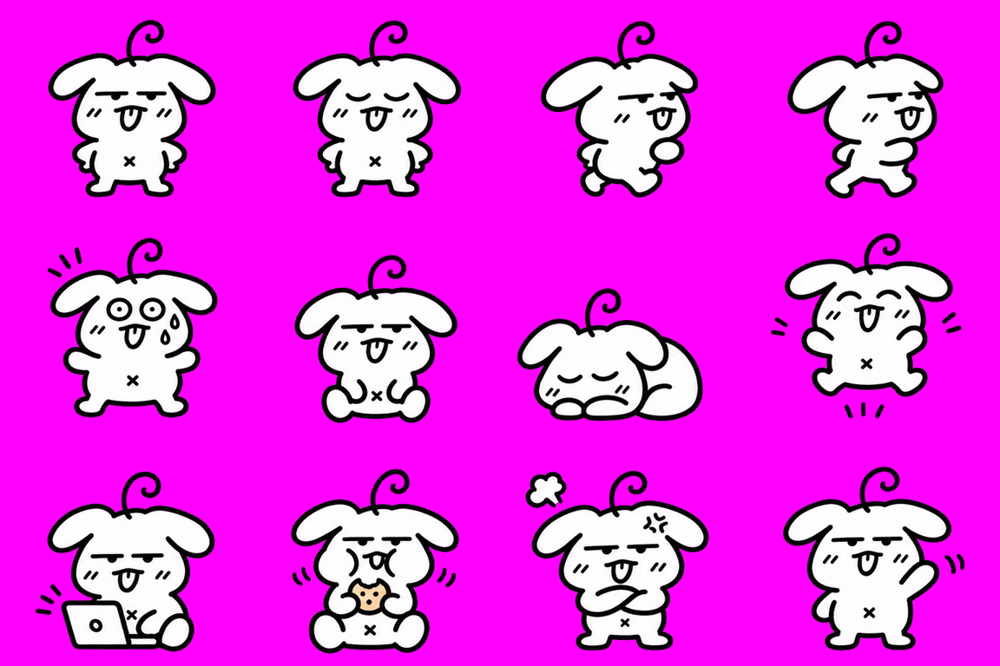

# 🐾 나만의 모니터 프렌즈 만들기 (ChatGPT 이미지 생성)

> 이 문서는 `npm run guide` 로 `src/shared/petPrompt.ts` 에서 만들어요. 요청문을 고칠 때는 그 파일을 고치세요.



## 순서

1. **사진과 요청문 준비** — 무엇으로 만들지(동물·사람·캐릭터·다리 없는 것·물건)와 그림체를 고르면 요청문이 맞춰져요. ChatGPT 를 열고 사진이나 그림을 첨부한 뒤 요청문을 붙여 넣어요. 영어 요청문이 더 잘 맞을 때가 많아요.
2. **그림 받기** — 12가지 포즈가 4칸 × 3줄로 그려진 그림이 나오면 PNG 로 내려받아요. 배경은 자홍색(분홍보라) 단색이거나 투명하면 가장 깔끔해요.
3. **앱에 끌어다 놓기** — 내려받은 그림을 이 창에 끌어다 놓으면 배경을 지우고 포즈 12개를 알아서 잘라 맞춰요.
4. **미리 보기 확인** — 칸마다 포즈가 순서대로 들어갔는지 봐요. 순서가 틀리거나 빠진 포즈가 있으면 "포즈 순서를 지켜서, 서로 더 띄워서 다시 그려 줘" 라고 부탁해 다시 받아요.
5. **다듬기** — 걷는 방향이 반대면 "걷기 뒤집기"를 켜요. 테두리에 배경색이 남으면 "배경 지우기" 막대를 오른쪽으로, 몸 일부가 지워지면 왼쪽으로 옮겨요.

## 요청문 (영어 · 추천)

```text
Turn the character in the attached image into a desktop pet and draw it as ONE sprite sheet image. It must be the SAME character as in the attached image — keep its face, colors, markings, outfit, hairstyle and accessories exactly; do not redesign it.

LAYOUT
- One landscape image, 1536×1024.
- A grid of 4 columns × 3 rows = 12 cells. Each cell shows the same character once, in the order below (left to right, then next row).
- The exact same character in all 12 cells: same face, same colors and markings, same body proportions.
- Same size and same camera distance in every cell. Whole body visible.
- Leave generous empty space between poses. Nothing overlaps and nothing crosses into another cell.
- Background: plain solid magenta #FF00FF filling the whole image (or a transparent background).
- No text, no numbers, no labels, no grid lines, no shadows, no ground line.

STYLE
- Keep the original art style, outfit, hairstyle and colors as faithfully as possible, just in a small full-body desktop-mascot proportion.
- Keep the original line and coloring style too; just make sure the shape reads at small size.

THE 12 POSES, IN ORDER
1. Standing, facing the viewer (default pose)
2. Exactly like pose 1 but with eyes closed (blink)
3. Walking, facing RIGHT — left foot forward
4. Walking, facing RIGHT — right foot forward (legs opposite to pose 3)
5. Surprised — wide round eyes, body stretched out, sweat drops
6. Sitting
7. Curled up sleeping, eyes closed (do not draw "zzz" letters)
8. Very happy — arms (or fins / body) up, smiling closed eyes, small jump
9. Typing on a tiny laptop
10. Eating something, cheeks puffed
11. Sulking / angry — puffed cheeks, arms crossed
12. Waving hello with one hand

Poses 3 and 4 must face RIGHT.
```

## 요청문 (한국어)

```text
첨부한 이미지 속 캐릭터를 데스크톱 펫으로 만들어서, 스프라이트 시트 한 장으로 그려 주세요. 첨부한 캐릭터와 똑같은 캐릭터여야 해요 — 얼굴·색·무늬·옷·머리 모양·소품 같은 특징을 바꾸지 말고 그대로 살려 주세요.

[전체 형식]
- 가로로 긴 1536×1024 그림 한 장.
- 가로 4칸 × 세로 3줄 = 12칸. 칸마다 같은 캐릭터를 한 번씩, 아래 순서대로 (왼쪽 위에서 오른쪽으로, 다음 줄로).
- 12칸 모두 똑같은 캐릭터: 같은 얼굴, 같은 색·무늬, 같은 몸 비율.
- 모든 칸에서 크기와 카메라 거리가 같게. 머리부터 발끝(몸 끝)까지 전체가 다 보이게.
- 포즈 사이를 넉넉히 띄워 주세요. 서로 겹치거나 칸 경계를 넘는 부분이 없게.
- 배경은 무늬 없는 단색 자홍색(#FF00FF)으로 가득. (또는 투명 배경)
- 글자·숫자·이름표·칸 테두리·그림자·바닥선은 넣지 마세요.

[그림체]
- 원본 그림체·옷·머리 모양·색을 최대한 그대로 살려 주세요. 다만 몸 전체가 보이는 작은 데스크톱 마스코트 비율로.
- 선·채색 방식도 원본 그대로. 작은 크기에서도 형태가 잘 보이게만 해 주세요.

[12칸 포즈 순서]
1. 정면으로 서 있기 (기본 자세)
2. 1번과 똑같은데 눈만 감음 (눈 깜빡임)
3. 오른쪽을 보고 걷기 — 왼발이 앞
4. 오른쪽을 보고 걷기 — 오른발이 앞 (3번과 다리가 반대)
5. 깜짝 놀람 — 눈 동그랗게, 몸을 쭉 펴고, 땀방울
6. 앉아 있기
7. 웅크리고 잠자기 (눈 감음, zzz 글자는 넣지 않기)
8. 신남 — 두 팔(또는 지느러미·몸) 번쩍, 눈웃음, 살짝 점프
9. 작은 노트북으로 타자 치기
10. 뭔가를 냠냠 먹기 (볼 빵빵)
11. 삐짐·화남 — 볼 부풀리기, 팔짱
12. 한 손 흔들며 인사

3·4번은 반드시 오른쪽을 향하게 그려 주세요.
```

## 잘 안 될 때

- **포즈가 12개가 아니거나 순서가 다름** → "포즈 순서를 지켜서, 서로 더 띄워서 다시 그려 줘"
- **포즈끼리 붙어 있음** → "칸마다 여백을 넉넉히, 칸 경계를 넘지 않게"
- **크기가 칸마다 다름** → "모든 칸에서 같은 크기·같은 카메라 거리로"
- **배경이 얼룩덜룩** → "배경은 무늬 없는 단색 #FF00FF 로 꽉 채워 줘"
- **걷는 방향이 왼쪽** → 앱의 "걷기 뒤집기" 를 켜면 돼요
- **흰 강아지·고양이** → 흰 배경은 몸까지 지워질 수 있어요. 자홍(#FF00FF) 배경이나 투명 배경으로 받으세요

## 앱이 그림을 처리하는 법

1. 배경 지우기: 투명 PNG 면 그대로, 아니면 가장자리 색을 배경으로 보고 바깥에서부터 지워요 (`src/renderer/src/common/sheet.ts`)
2. 포즈 나누기: 빈 가로줄로 3줄, 빈 세로줄로 4칸을 찾아요. 안 되면 4×3 칸으로 고르게 잘라요
3. 크기 맞추기: '서기' 포즈 키를 기준으로 모든 포즈를 같은 배율로 줄이고, 발바닥을 같은 높이에 맞춰요
4. 결과는 1024×768 투명 PNG (4×3, 칸 256) 로 저장돼요. 이 파일(`.프렌즈.png`)을 친구에게 보내면 친구도 그대로 가져올 수 있어요
